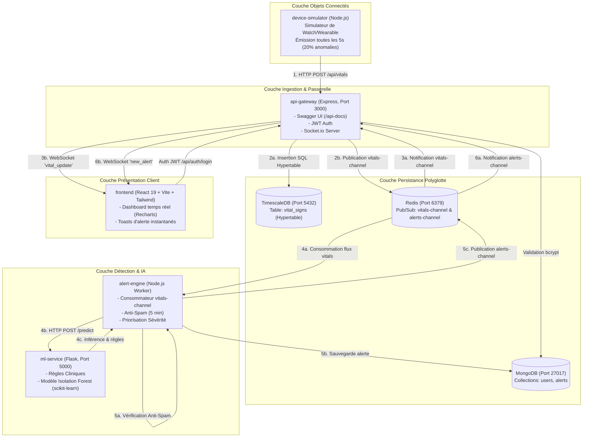

# 🏥 Rapport d'Analyse Approfondie & Manuel d'Exécution
## Plateforme de Télésurveillance Médicale IoMT (*Internet of Medical Things*) - Projet de Fin d'Études (PFE)

---

## 📋 Table des Matières
1. [Introduction & Résumé Exécutif](#1-introduction--résumé-exécutif)
2. [Cartographie de l'Architecture Système](#2-cartographie-de-larchitecture-système)
3. [Analyse Détaillée Composant par Composant](#3-analyse-détaillée-composant-par-composant)
   - [Simulateur d'Objets Connectés (`device-simulator`)](#31-simulateur-dobjets-connectés-device-simulator)
   - [Passerelle API & Temps Réel (`api-gateway`)](#32-passerelle-api--temps-réel-api-gateway)
   - [Moteur d'Alertes Intelligent (`alert-engine`)](#33-moteur-dalertes-intelligent-alert-engine)
   - [Microservice Machine Learning (`ml-service`)](#34-microservice-machine-learning-ml-service)
   - [Frontend Utilisateur (`frontend`)](#35-frontend-utilisateur-frontend)
   - [Couche de Persistance Polyglotte](#36-couche-de-persistance-polyglotte)
4. [Moteur de Détection d'Anomalies Hybride & IA](#4-moteur-de-détection-danomalies-hybride--ia)
5. [Audit Technique : Failles, Gaps Détectés & Correctifs Apportés](#5-audit-technique--failles-gaps-détectés--correctifs-apportés)
6. [Schémas de Données & Modèles](#6-schémas-de-données--modèles)
7. [Manuel d'Exécution & Déploiement](#7-manuel-dexécution--déploiement)
   - [Méthode 1 : Démarrage Clé en Main avec Docker Compose (Recommandée)](#71-méthode-1--démarrage-clé-en-main-avec-docker-compose-recommandée)
   - [Méthode 2 : Démarrage Manuel Pas-à-Pas (Local sans Docker)](#72-méthode-2--démarrage-manuel-pas-à-pas-local-sans-docker)
   - [Scénario de Test & Démonstration Complète](#73-scénario-de-test--démonstration-complète)
8. [Guide de Dépannage (Troubleshooting)](#8-guide-de-dépannage-troubleshooting)
9. [Perspectives d'Amélioration pour la Soutenance PFE](#9-perspectives-damélioration-pour-la-soutenance-pfe)

---

## 1. Introduction & Résumé Exécutif

Ce projet implémente une **Plateforme de Télésurveillance Médicale Connectée (IoMT)** développée dans le cadre d'un **Projet de Fin d'Études (PFE)**. Elle répond à un besoin critique du secteur de la e-santé : **la surveillance continue, proactive et en temps réel de patients à distance**, couplée à une détection automatisée d'anomalies cliniques évitant la surcharge cognitive du personnel soignant (*alert fatigue*).

### Points Clés du Projet :
- **Architecture Microservices Réactive & Événementielle :** Découplage strict entre ingestion, stockage, détection d'alertes, inférence d'apprentissage automatique et restitution client.
- **Télémétrie en Temps Réel :** Ingestion et diffusion de flux physiologiques continus via Redis Pub/Sub et WebSockets (Socket.io).
- **Détection d'Anomalies Hybride :** Combinaison de **règles cliniques déterministes** (bradycardie, tachycardie, hypoxie, hypertension/hypotension) et d'un modèle non-supervisé de **Machine Learning (Isolation Forest)**.
- **Logique Anti-Spam Médicale :** Système de temporisation (*debouncing* de 5 minutes par type d'alerte et par patient) pour éviter le bombardement de notifications redondantes.
- **Persistance Polyglotte :**
  - **TimescaleDB (PostgreSQL) :** Optimisé pour les séries temporelles haute fréquence.
  - **MongoDB :** Adapté aux données documentaires flexibles (profils utilisateurs, logs d'alertes).
  - **Redis :** Bus de messages en mémoire ultra-rapide.

---

## 2. Cartographie de l'Architecture Système

Le diagramme ci-dessous illustre l'ensemble des flux réseau, protocoles et interactions entre microservices :



---

## 3. Analyse Détaillée Composant par Composant

### 3.1. Simulateur d'Objets Connectés (`device-simulator`)
- **Rôle :** Émule un dispositif médical porté par un patient (`patient_001`, dispositif `smartwatch_123`).
- **Périodicité :** Génère un payload JSON toutes les **5 secondes**.
- **Variables Physiologiques :**
  - Rythme Cardiaque (`heartRate`) : 60 à 100 bpm (nominal).
  - Saturation en Oxygène (`spo2`) : 95% à 100% (nominal).
  - Pression Artérielle Systolique (`systolic`) : 110 à 140 mmHg (nominal).
  - Pression Artérielle Diastolique (`diastolic`) : 70 à 90 mmHg (nominal).
- **Injection d'Anomalies :**
  - Probabilité de 20% (`Math.random() < 0.2`) d'injecter une situation critique :
    - `heartRate = 160 bpm` (déclencheur de tachycardie sévère).
    - `spo2 = 88%` (déclencheur d'hypoxie).

---

### 3.2. Passerelle API & Temps Réel (`api-gateway`)
- **Technologie :** Node.js, Express 4.19, Socket.io 4.8.
- **Rôles Multiples :**
  1. **Ingestion des signes vitaux (`POST /api/vitals`) :**
     - Valide le corps de la requête.
     - Écrit immédiatement dans TimescaleDB (`vital_signs`).
     - Publie la mesure sur le canal Redis `vitals-channel`.
  2. **Diffusion WebSocket :**
     - S'abonne aux canaux Redis `vitals-channel` et `alerts-channel`.
     - Réémet vers les clients connectés via les événements Socket.io `vital_update` et `new_alert`.
  3. **Gestion des Identités & Sécurité :**
     - `POST /api/auth/register` : Inscription avec hachage de mot de passe par `bcryptjs` (salt rounds = 10).
     - `POST /api/auth/login` : Authentification et délivrance d'un jeton JWT valide 24 heures.
     - `GET /api/users/me` : Route protégée par le middleware `auth.js` (`Bearer <token>`).
  4. **Documentation Interactive :**
     - Intègre Swagger UI accessible sur `/api-docs` pour tester directement les endpoints.

---

### 3.3. Moteur d'Alertes Intelligent (`alert-engine`)
- **Technologie :** Node.js worker avec Mongoose et ioredis.
- **Traitement Asynchrone :**
  - Ne bloque pas la passerelle d'ingestion. Il écoute passivement le bus Redis `vitals-channel`.
  - Transfère les constantes vitales au microservice Machine Learning via `POST http://ml-service:5000/predict`.
- **Mécanisme Anti-Spam Médical :**
  - Problématique : Un capteur envoyant une anomalie toutes les 5 secondes déclencherait 720 alertes par heure.
  - Solution : Une fenêtre de blocage de 5 minutes (`SPAM_WINDOW_MS = 300 000 ms`) par clé composite `${patientId}_${alertType}`.
- **Classification de la Sévérité :**
  - `'critical'` : Alertes préfixées par `critical_` (ex: `critical_tachycardia`, `critical_bradycardia`) ainsi que `hypoxia`, `hypertension`, `hypotension`.
  - `'warning'` : Anomalies détectées par l'Isolation Forest sans franchissement de seuil critique immédiat.
- **Persistance & Diffusion :**
  - Enregistre l'alerte dans MongoDB (`Alert`).
  - Publie l'alerte sur `alerts-channel` pour affichage instantané dans le navigateur.

---

### 3.4. Microservice Machine Learning (`ml-service`)
- **Technologie :** Python 3.11, Flask 3.0, scikit-learn 1.5, NumPy, Pandas, Joblib.
- **Architecture Hybride :**
  1. **Moteur Heuristique Médical :** Évaluation de seuils physiologiques stricts.
  2. **Modèle Non-Supervisé Isolation Forest :** Détection de corrélations anormales multidimensionnelles `[heartRate, spo2, systolic]`.
- **Script d'Entraînement (`train_models.py`) :**
  - Génère 1000 échantillons normaux synthétiques et calibre le modèle avec une hypothèse de contamination de 10% (`contamination=0.1`).
  - Sérialise le modèle dans `models/isolation_forest_v1.pkl`.
- **Endpoint `/predict` :**
  - Reçoit les constantes physiologiques, exécute les deux niveaux de détection, et retourne :
    ```json
    {
      "is_anomaly": true,
      "rules_triggered": ["critical_tachycardia", "hypoxia"]
    }
    ```

---

### 3.5. Frontend Utilisateur (`frontend`)
- **Technologie :** React 19, TypeScript, Vite, Tailwind CSS, Recharts, Socket.io-client, react-hot-toast.
- **Fonctionnalités :**
  - **Écran de Connexion (`LoginPage.tsx`) :** Formulaire pré-rempli, gestion des erreurs serveur et stockage du JWT dans `localStorage`.
  - **Protection des Routes (`PrivateRoute`) :** Redirection automatique vers `/login` si aucun token n'est présent.
  - **KPIs en Temps Réel (`MetricCard.tsx`) :** Cartes dynamiques affichant Rythme Cardiaque (bpm), Saturation SpO2 (%) et Pression Artérielle (mmHg).
  - **Graphique Dynamique Glissant (`DashboardPage.tsx`) :** Graphique Recharts conservant un historique glissant des 20 dernières mesures avec deux axes Y indépendants.
  - **Notifications Push d'Urgence :** Bannières d'alerte rouges persistantes (6 secondes) déclenchées à la réception d'un événement `new_alert`.

---

### 3.6. Couche de Persistance Polyglotte

| Base de Données | Rôle dans l'Architecture | Justification Technique |
| :--- | :--- | :--- |
| **TimescaleDB** (PostgreSQL) | Stockage des séries temporelles des signes vitaux (`vital_signs`) | Gestion native du partitionnement temporel (hypertables), compression automatique, requêtes analytiques rapides. |
| **MongoDB** | Stockage des utilisateurs (`users`) et du journal des alertes (`alerts`) | Schémas documentaires flexibles, requêtage JSON rapide, persistance des alertes avec métadonnées variables. |
| **Redis** | Bus de messages Pub/Sub en mémoire | Latence inférieure à la milliseconde pour la distribution des flux temps réel vers l'API Gateway et l'Alert Engine. |

---

## 4. Moteur de Détection d'Anomalies Hybride & IA

Le système combine deux approches complémentaires pour maximiser la sensibilité tout en réduisant les faux positifs :

```
                  Mesure Vitale Reçue: { HR, SpO2, Systolic, Diastolic }
                                           |
                    +----------------------+----------------------+
                    |                                             |
                    v                                             v
        [ Règles Cliniques Fixes ]                   [ Isolation Forest (ML) ]
        - HR < 40 : critical_bradycardia             - Espace 3D: [HR, SpO2, Sys]
        - HR > 150 : critical_tachycardia            - Partitionnement récursif par arbres
        - SpO2 < 90 : hypoxia                        - Score d'isolement < seuil (-1)
        - Sys < 90 : hypotension
        - Sys > 180 : hypertension
                    |                                             |
                    +----------------------+----------------------+
                                           |
                                           v
                             Fusion des Décisions:
                  is_anomaly = (règles_activées OR score_ml == -1)
                                           |
                                           v
                             Filtre Anti-Spam (5 minutes)
                                           |
                       +-------------------+-------------------+
                       |                                       |
                   Bloqué (Spam)                           Autorisé
                   (Ignoré)                         1. Sauvegarde dans MongoDB
                                                    2. Émission WebSocket Frontend
```

### Table de Correspondance des Anomalies :
| Condition Clinique | Métrique | Seuil Déclenché | Sévérité Déduite |
| :--- | :--- | :--- | :--- |
| Bradycardie Critique | Rythme Cardiaque | `< 40 bpm` | **Critical** |
| Tachycardie Critique | Rythme Cardiaque | `> 150 bpm` | **Critical** |
| Hypoxie Sévère | Saturation SpO2 | `< 90 %` | **Critical** |
| Hypotension Sévère | Pression Systolique | `< 90 mmHg` | **Critical** |
| Hypertension Sévère | Pression Systolique | `> 180 mmHg` | **Critical** |
| Déviation Multivariée | Combinaison complexe | Prédiction `IsolationForest == -1` | **Warning** |

---

## 5. Audit Technique : Failles, Gaps Détectés & Correctifs Apportés

Lors de l'analyse approfondie du code source brut, **6 anomalies critiques empêchant le démarrage ou le fonctionnement correct ont été identifiées**. Nous les avons toutes corrigées :

| # | Composant | Problème Détecté dans le Code Initial | Impact | Correctif Apporté |
| :--- | :--- | :--- | :--- | :--- |
| **1** | **Global** | Aucun fichier `docker-compose.yml` ni `Dockerfile` n'existait dans le projet, malgré la mention explicite dans le README. | Impossible d'exécuter l'architecture microservices comme documenté. | **Création du `docker-compose.yml` complet** et de **5 Dockerfiles optimisés** (`api-gateway`, `alert-engine`, `device-simulator`, `ml-service`, `frontend`). |
| **2** | **`api-gateway`** | Absence de middleware CORS pour Express dans `api-gateway/index.js` (seul Socket.io avait CORS). | Le navigateur bloque toutes les requêtes REST (`/api/auth/login`) depuis `http://localhost:5173` pour violation CORS. | **Ajout d'un middleware CORS natif** avec gestion des pré-requêtes `OPTIONS`. |
| **3** | **`api-gateway`** | `dotenv` n'était pas importé dans `api-gateway/index.js` et absent de son `package.json`. | En exécution locale sans Docker, `process.env.MONGO_URI` vaut `undefined` et le serveur crashe au boot. | **Ajout du chargement dynamique `dotenv`** avec repli automatique sur les chemins racine et variables par défaut. |
| **4** | **Config `.env`** | Discordance des noms de variables : `.env.example` définissait `REDIS_URL` et `ML_URL`, alors que les services lisaient `REDIS_URI` et `ML_SERVICE_URL`. De même pour `PG_CONN` vs `DB_HOST`. | Erreurs de connexion silencieuses ou plantages de l'alert-engine et de la passerelle. | **Harmonisation complète du fichier `.env`** et ajout de fallbacks bidirectionnels dans le code Node.js. |
| **5** | **TimescaleDB** | Aucune table SQL `vital_signs` ni initialisation de l'extension TimescaleDB n'était fournie. | Chaque `POST /api/vitals` échouait avec `relation "vital_signs" does not exist`. | **Création du script d'initialisation `init-db/init-timescale.sql`** automatiquement monté dans le container TimescaleDB. |
| **6** | **Données Démo** | Le frontend propose les identifiants `patient1@demo.com` / `password123`, mais aucun utilisateur n'existait en base. | Impossible de se connecter sans créer manuellement un compte via Swagger. | **Création du script de population `scripts/seed-demo-user.js`** pour créer l'utilisateur démo en un clic. |

---

## 6. Schémas de Données & Modèles

### 6.1. TimescaleDB : Table `vital_signs`
```sql
CREATE EXTENSION IF NOT EXISTS timescaledb CASCADE;

CREATE TABLE IF NOT EXISTS vital_signs (
    time TIMESTAMPTZ NOT NULL,
    patient_id VARCHAR(50) NOT NULL,
    device_id VARCHAR(50),
    heart_rate INTEGER,
    spo2 INTEGER,
    systolic INTEGER,
    diastolic INTEGER
);

SELECT create_hypertable('vital_signs', 'time', if_not_exists => TRUE);
CREATE INDEX IF NOT EXISTS idx_vital_signs_patient_time ON vital_signs (patient_id, time DESC);
```

### 6.2. MongoDB : Collection `users`
```javascript
{
  "_id": ObjectId("..."),
  "email": "patient1@demo.com",
  "password": "$2a$10$... (hash bcrypt)",
  "role": "patient", // enum: ['patient', 'doctor', 'admin']
  "profile": {
    "firstName": "Jean",
    "lastName": "Dupont"
  },
  "createdAt": ISODate("..."),
  "updatedAt": ISODate("...")
}
```

### 6.3. MongoDB : Collection `alerts`
```javascript
{
  "_id": ObjectId("..."),
  "patientId": "patient_001",
  "deviceId": "smartwatch_123",
  "type": "critical_tachycardia",
  "severity": "critical", // enum: ['info', 'warning', 'critical']
  "message": "Anomalie critical: tachycardia",
  "metrics": {
    "heartRate": 160,
    "spo2": 88,
    "bloodPressure": {
      "systolic": 130,
      "diastolic": 85
    }
  },
  "isAcknowledged": false,
  "createdAt": ISODate("..."),
  "updatedAt": ISODate("...")
}
```

---

## 7. Manuel d'Exécution & Déploiement

Deux méthodes sont disponibles :
- **Méthode 1 (Recommandée) :** Déploiement complet en un seul clic avec **Docker Compose**.
- **Méthode 2 :** Démarrage pas-à-pas en local (idéal pour le débogage de code source).

---

### 7.1. Méthode 1 : Démarrage Clé en Main avec Docker Compose (Recommandée)

#### Prérequis :
- **Docker Desktop** installé et démarré sur votre machine.

#### Étape 1 : Vérifier que Docker Desktop est actif
Ouvrez PowerShell et tapez :
```powershell
docker info
```
*(Si une erreur de socket ou de daemon apparaît, lancez simplement l'application Docker Desktop sur Windows et attendez l'icône verte).*

#### Étape 2 : Lancer la stack complète
Dans le répertoire racine du projet (`Health-Monitoring-Platform-main`) :
```powershell
docker compose up --build
```

#### Étape 3 : Créer l'utilisateur démo
Dès que les conteneurs sont lancés, ouvrez un deuxième terminal PowerShell et exécutez le script de seeding :
```powershell
docker compose exec api-gateway node /app/../scripts/seed-demo-user.js
```
*(Ou utilisez la route Swagger `POST /api/auth/register` détaillée ci-après).*

#### Étape 4 : Accéder aux interfaces
| Service | URL | Identifiants / Notes |
| :--- | :--- | :--- |
| **Dashboard Patient** | [http://localhost:5173](http://localhost:5173) | `patient1@demo.com` / `password123` |
| **Dashboard Médecin** | [http://localhost:5173/doctor](http://localhost:5173/doctor) | `doctor@demo.com` / `password123` |
| **Documentation Swagger UI** | [http://localhost:3000/api-docs](http://localhost:3000/api-docs) | Test interactif de l'API Gateway |
| **API Gateway Root** | [http://localhost:3000/](http://localhost:3000/) | Statut de l'API |
| **ML Service Health Check** | [http://localhost:5000/](http://localhost:5000/) | Statut du modèle Isolation Forest |

Pour arrêter tous les conteneurs :
```powershell
docker compose down
```

---

### 7.2. Méthode 2 : Démarrage Manuel Pas-à-Pas (Local sans Docker)

Si vous préférez exécuter les composants directement sur votre machine hôte :

#### Prérequis Locaux :
1. **Node.js** (v18+) et **npm**
2. **Python** (3.10+) avec `pip`
3. Instances locales ou containers pour les bases de données :
   - **MongoDB** sur le port `27017`
   - **PostgreSQL / TimescaleDB** sur le port `5432` (avec le script `init-db/init-timescale.sql` exécuté)
   - **Redis** sur le port `6379`

> [!TIP]
> Si vous disposez de Docker, vous pouvez lancer **uniquement les bases de données** en arrière-plan via :
> ```powershell
> docker compose up -d mongo timescaledb redis
> ```

---

#### Terminal 1 : Lancement du Microservice Machine Learning
```powershell
cd ml-service
python -m venv venv
.\venv\Scripts\activate
pip install -r requirements.txt
python train_models.py
python app.py
```
*Le service écoute sur `http://localhost:5000`.*

---

#### Terminal 2 : Initialisation & Lancement de l'API Gateway
```powershell
cd api-gateway
npm install
node ..\scripts\seed-demo-user.js
npm start
```
*Le serveur écoute sur `http://localhost:3000` et Swagger est disponible sur `http://localhost:3000/api-docs`.*

---

#### Terminal 3 : Lancement du Moteur d'Alertes
```powershell
cd alert-engine
npm install
npm start
```
*Le service se connecte à Redis et MongoDB, et écoute le canal `vitals-channel`.*

---

#### Terminal 4 : Lancement du Frontend Web
```powershell
cd frontend
npm install
npm run dev
```
*L'interface web s'ouvre sur `http://localhost:5173`.*

---

#### Terminal 5 : Lancement du Simulateur IoMT
```powershell
cd device-simulator
npm install
npm start
```
*Le simulateur commence à injecter des mesures vers `http://localhost:3000/api/vitals` toutes les 5 secondes.*

---

### 7.3. Scénario de Test & Démonstration Complète

1. **Connexion au Dashboard :**
   - Rendez-vous sur `http://localhost:5173`.
   - Cliquez sur **Se connecter** (les identifiants `patient1@demo.com` / `password123` sont déjà saisis).
2. **Observation du Flux Normal :**
   - Les cartes **Rythme Cardiaque**, **Saturation (SpO2)** et **Pression Artérielle** s'actualisent toutes les 5 secondes.
   - La courbe Recharts trace l'évolution temporelle glissante.
3. **Observation des Alertes Critiques & Anti-Spam :**
   - Environ 1 fois sur 5 (20%), le simulateur injecte une anomalie (`heartRate: 160`, `spo2: 88`).
   - L'`alert-engine` interroge le `ml-service`. Le modèle et les règles détectent `critical_tachycardia` et `hypoxia`.
   - Une **alerte rouge** apparaît instantanément en haut à droite du tableau de bord via `react-hot-toast`.
   - Si une nouvelle anomalie identique arrive dans les 5 minutes, observez dans les logs de l'`alert-engine` :
     ```text
     [Anti-Spam] Alerte critical_tachycardia pour patient_001 bloquée (trop récente).
     ```
     L'anti-spam a correctement protégé le soignant de la saturation de notifications !

---

## 8. Guide de Dépannage (Troubleshooting)

### Q1 : Docker indique `failed to connect to the docker API at npipe`
- **Cause :** Docker Desktop n'est pas lancé sur Windows.
- **Solution :** Ouvrez Docker Desktop depuis le menu Démarrer de Windows et attendez son initialisation complète.

### Q2 : Erreur `relation "vital_signs" does not exist`
- **Cause :** La table TimescaleDB n'a pas été initialisée.
- **Solution :** Si vous utilisez Docker, le fichier `init-db/init-timescale.sql` est monté automatiquement au premier démarrage. Si la base existait déjà, exécutez la commande :
  ```powershell
  docker compose exec timescaledb psql -U postgres -d timescale -f /docker-entrypoint-initdb.d/init-timescale.sql
  ```

### Q3 : `Identifiants invalides` sur la page de connexion
- **Cause :** L'utilisateur démo n'est pas encore présent dans MongoDB.
- **Solution :** Exécutez le script :
  ```powershell
  node scripts/seed-demo-user.js
  ```
  Ou créez un compte manuellement via Swagger UI sur `http://localhost:3000/api-docs` (route `POST /api/auth/register`).

### Q4 : Le frontend affiche une erreur d'installation npm (`rolldown-vite`)
- **Cause :** `frontend/package.json` spécifie une version expérimentale de Vite via override.
- **Solution :** Si npm signale un conflit de dépendance, installez avec l'option legacy :
  ```powershell
  npm install --legacy-peer-deps
  ```

---

## 9. Perspectives d'Amélioration pour la Soutenance PFE

Pour valoriser ce projet devant le jury de soutenance, voici les axes d'évolution recommandés :

1. **Cloisonnement Multi-Patients par Salons WebSockets (*Rooms*) :**
   - Actuellement, `io.emit('vital_update', data)` diffuse à tous les clients connectés.
   - *Amélioration :* Utiliser `socket.join(patientId)` pour que chaque patient ou médecin n'écoute que le flux qui le concerne.
2. **Anti-Spam Distribué via Redis TTL :**
   - Remplacer l'objet en mémoire `recentAlerts` de l'`alert-engine` par des clés Redis avec expiration native (`SET key value EX 300 NX`), permettant de faire tourner plusieurs répliques de l'alert-engine sans conflit.
3. **Tableau de Bord Médecin Multi-Patients :**
   - Créer une vue dédiée aux docteurs récapitulant la liste de leurs patients assignés, avec tri par niveau de risque ou sévérité des alertes.
4. **Notifications d'Urgence SMS/Email :**
   - Interconnecter l'`alert-engine` avec des services comme Twilio (SMS) ou SendGrid (Email) pour alerter les médecins de garde en cas d'alerte `critical`.
5. **Enrichissement du Modèle IA :**
   - Entraîner l'Isolation Forest ou un Autoencodeur Deep Learning (LSTM) sur des jeux de données médicaux réels (ex: PhysioNet, MIMIC-III) pour détecter des arythmies complexes.
