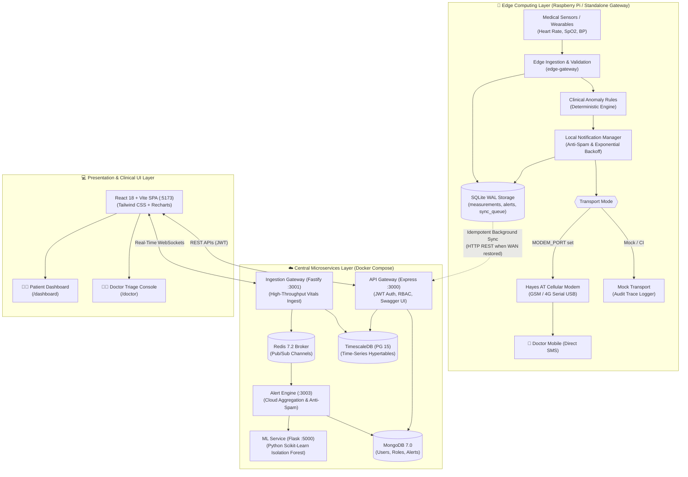
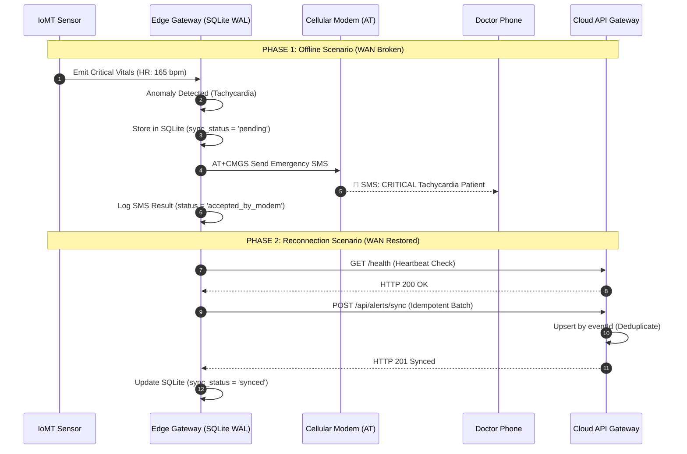
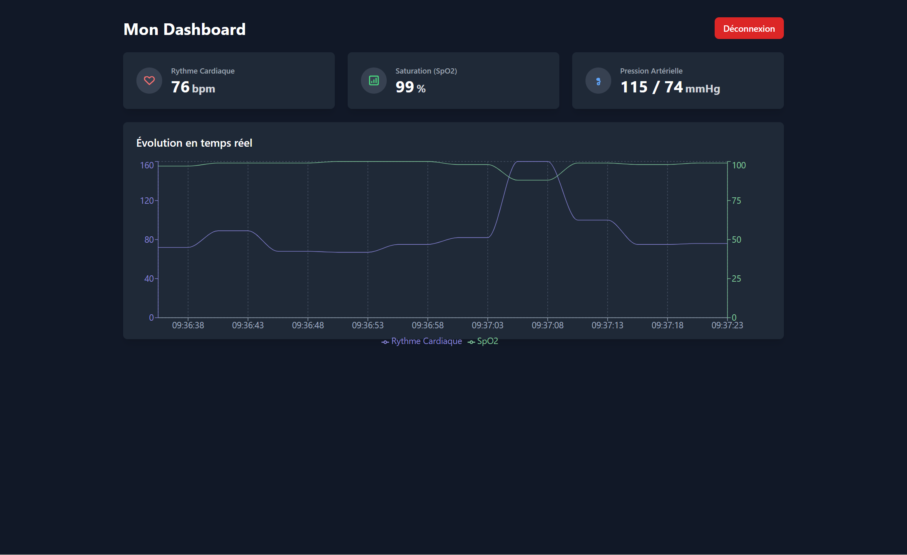
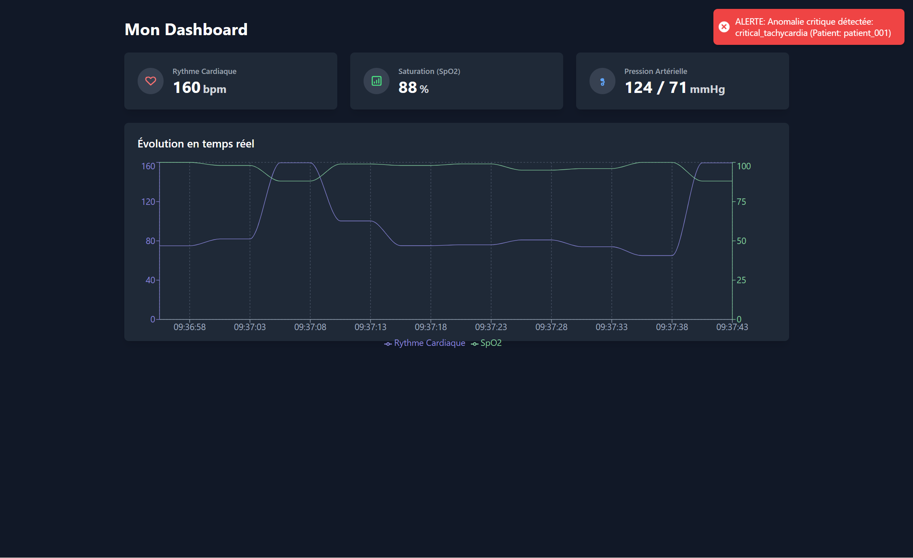
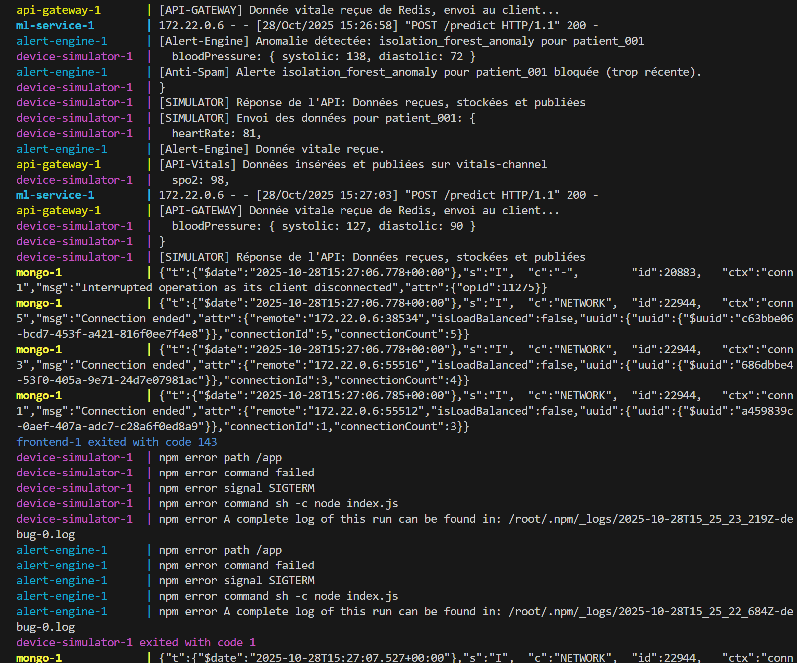
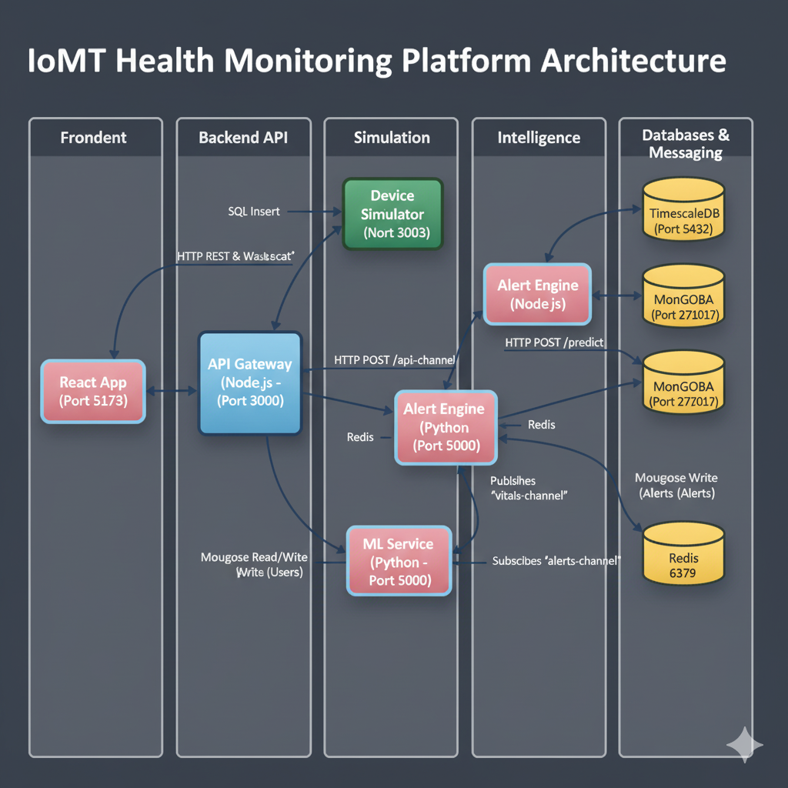

# 🏥 Resilient Edge-Enabled IoMT Remote Patient Monitoring Platform

[](edge-gateway/test/edge.test.js)
[](#-system-architecture)
[](#-getting-started--reproducibility-manual)
[](edge-gateway/)
[](ml-service/)
[](frontend/)
[](#-polyglot-persistence-architecture)
[](LICENSE)

> **An autonomous Internet of Medical Things (IoMT) system featuring edge intelligence, direct cellular SMS emergency alerting, dual-tier anomaly detection, and offline-first zero-cloud-dependency resilience.**  
> *Developed as an academic Master's Capstone (*Projet de Fin d'Études - PFE*) in Software Engineering, Distributed Systems, and Edge IoT.*

---

## 📑 Table of Contents

- [Overview & Problem Statement](#-overview--problem-statement)
- [Key Features](#-key-features)
- [System Architecture](#-system-architecture)
- [Visual Showcase & Dashboards](#-visual-showcase--dashboards)
- [Technology Stack](#-technology-stack)
- [How It Works (End-to-End Workflow)](#-how-it-works-end-to-end-workflow)
- [Getting Started & Reproducibility Manual](#-getting-started--reproducibility-manual)
- [Verification & Automated Testing](#-verification--automated-testing)
- [Edge & Hardware Deployment Guide (Raspberry Pi)](#-edge--hardware-deployment-guide-raspberry-pi)
- [Security, Clinical Safety & Data Protection](#-security-clinical-safety--data-protection)
- [Research & Academic Contributions](#-research--academic-contributions)
- [Repository Structure](#-repository-structure)
- [Documentation & Technical Report](#-documentation--technical-report)
- [License & Contact](#-license--contact)

---

## 💡 Overview & Problem Statement

Modern remote patient monitoring (RPM) platforms stream physiological vitals—such as heart rate, oxygen saturation ($\text{SpO}_2$), and blood pressure—to centralized cloud backends for analysis. However, this **cloud-centric paradigm introduces a critical single point of failure**: if broadband connectivity fails, local Wi-Fi drops, or the cloud infrastructure experiences latency spikes, life-critical notifications fail to reach clinicians during acute clinical events (e.g., ventricular tachycardia, sudden hypoxemia, or hypertensive crises).

Furthermore, continuous high-frequency IoMT telemetry streams often lead to severe **clinical alert fatigue** when naive systems dispatch duplicate notifications without contextual rate-limiting or validation.

```
Conventional Cloud Architecture (Vulnerable):
[Sensors] ──(Wi-Fi)──> [Router] ──(WAN/Internet)──> [Cloud Server] ──(Third-Party API)──> [Doctor]
                                       ❌ WAN Outage = No Alert Delivered!

Our Autonomous Edge Architecture (Resilient):
[Sensors] ──(BLE/Serial)──> [Edge Gateway (RPi)] ──(Hayes AT Serial)──> [GSM/LTE Modem] ──> [Doctor SMS]
                                   │                                                      (INSTANT, NO INTERNET)
                                   └──(When WAN Reconnects)──> [Cloud Sync & Central Lake]
```

### Core Engineering Contribution

This platform implements a **resilient edge-first IoMT architecture** deployable on embedded hardware (such as a Raspberry Pi):
1. **Autonomous Edge Alerting:** Evaluates physiological vitals locally and initiates physical SMS dispatch directly via hardware cellular modems (3GPP Hayes AT commands) with **zero dependency on internet connectivity or central cloud availability**.
2. **ACID Offline Persistence & WAL Storage:** Embedded SQLite operating in Write-Ahead Logging (WAL) mode guarantees zero telemetry loss across network blackouts and abrupt power interruptions.
3. **Idempotent Cloud Synchronization:** Once cloud connectivity is restored, the edge gateway idempotently synchronizes buffered vitals and historical alert audit logs without duplicating events.
4. **Dual-Tier Anomaly Detection:** Deterministic clinical threshold rules on the edge operate alongside cloud-based unsupervised machine learning (**Isolation Forest**) to capture subtle multi-variate decompensation patterns.
5. **Anti-Spam Suppression & Clinician Safety:** State-aware debouncing suppresses duplicate alerts within a configurable 5-minute cool-down window per condition, mitigating alert fatigue while preserving emergency escalations.

---

## ✨ Key Features

### 🛡️ Autonomous Edge Intelligence & Offline Resilience
- **Zero-Cloud Dependency:** The edge gateway (`edge-gateway`) processes and validates telemetry independently on a local single-board computer (Raspberry Pi).
- **WAL-Mode Local Persistence:** Uses embedded SQLite (`node:sqlite`) with Write-Ahead Logging for high-throughput concurrent writes and crash resilience.
- **Sensor Health vs. Medical Emergency:** Separates physiological anomalies from device dropouts. A silent sensor ($>20\text{s}$) generates a `warning` (`sensor_disconnected`), preventing false clinical emergencies.

### 📱 Direct Cellular SMS Emergency Alerting
- **Hardware Cellular Transport:** Dispatches emergency SMS messages over serial channels via Hayes AT commands (`modemTransport.js`), interfacing with USB GSM/4G modems (e.g., Quectel EC25, Huawei E3372, SIM7600).
- **Mock Transport for Automated CI:** Seamlessly toggles to an in-memory transport (`mockTransport.js`) during development and CI testing with full audit trail logging.
- **Bounded Exponential Backoff:** Re-attempts transient cellular transmission failures ($1\text{s} \to 2\text{s} \to 4\text{s}$, max 3 retries) and records exact delivery attempt states (`pending`, `accepted_by_modem`, `failed`).

### 🧠 Dual-Tier Anomaly Detection
- **Edge Clinical Thresholds:** Hard clinical safety limits trigger sub-second alerts for life-threatening vitals ($\text{HR} < 40$ or $> 150\text{ bpm}$, $\text{SpO}_2 < 90\%$, $\text{Systolic BP} < 90$ or $> 180\text{ mmHg}$).
- **Cloud Isolation Forest ML:** A dedicated microservice (`ml-service`) written in Python 3.11 with scikit-learn scores multivariate data vectors to detect non-linear physiological drift before acute crises manifest.

### 📊 Multi-Role Web Applications
- **Patient Dashboard:** React 18 single-page application rendering real-time streaming Recharts graphs, active alert banners, and telemetry history via WebSockets and REST.
- **Doctor Clinical Triage Console:** Role-protected interface (`/doctor`) enabling clinicians to review multi-patient status, filter by urgency (`critical`, `warning`), acknowledge active alerts, and inspect edge sync health.

### 🗄️ Polyglot Persistence Architecture
- **TimescaleDB (PostgreSQL 15):** Relational hypertables optimized for time-series ingestion and temporal analytical queries over millions of vital records.
- **MongoDB 7.0:** Document store for user profiles, clinical role mappings, and structured alert event documents.
- **Redis 7.2:** Low-latency in-memory broker handling pub/sub message distribution across ingestion microservices and WebSocket streams.

### 🔒 Clinical Safety & Security
- **Anti-Spam Rate-Limiting:** 5-minute debouncing window per condition per patient suppresses repetitive alerts while allowing new clinical symptoms to trigger immediately.
- **Stateless JWT & Strict RBAC:** Role-based access control enforces strict data isolation: patients can only query their own vitals (HTTP 403 on cross-tenant access), while certified doctors have broad clinical triage authority.

---

## 🏗️ System Architecture

The platform follows a decoupled, event-driven microservices architecture partitioned into three operational tiers: the **Edge Layer**, the **Central/Cloud Layer**, and the **Presentation Layer**.



### Edge Offline-to-Online Synchronization Flow



---

## 📸 Visual Showcase & Dashboards

### Real-Time Patient Portal
*Real-time streaming biometric telemetry (Heart Rate, $\text{SpO}_2$, Blood Pressure) with historical Recharts visualization and vital trend evaluation.*



---

### Critical Emergency Notification Modal
*Immediate visual escalation triggered upon physiological threshold violation (Tachycardia $>150\text{ bpm}$) with auditory and visual clinical alerts.*



---

### Anti-Spam Rate-Limiting & ML Ingestion Console
*Terminal telemetry execution verifying dual-tier anomaly detection (Isolation Forest) and anti-spam suppression within the 5-minute cool-down window.*



---

### Architectural Concept Diagram
*Conceptual edge-to-cloud topology orchestrating autonomous cellular modems, edge persistence, microservices containers, and clinical interfaces.*



---

## 🛠️ Technology Stack

| Layer / Component | Technology | Version | Purpose |
| :--- | :--- | :--- | :--- |
| **Edge Gateway** | Node.js / `node:sqlite` | v20+ LTS | Autonomous edge processing, WAL ACID storage, AT modem driver |
| **Frontend Framework** | React / TypeScript | React 18.3 / TS 5.2 | Component-driven reactive user interface |
| **Build & Tooling** | Vite | Vite 5.4 | Fast HMR development server and optimized production bundling |
| **UI & Visuals** | Tailwind CSS / Lucide-React | Tailwind 3.4 / Lucide 0.344 | Modern, accessible clinical styling and medical iconography |
| **Telemetry Charts** | Recharts | Recharts 2.12 | Responsive real-time SVG charting of patient vitals |
| **API Gateway** | Express / JWT | Express 4.18 | REST routing, stateless JWT validation, RBAC, Swagger documentation |
| **Ingestion Engine** | Fastify / WebSocket | Fastify 4.26 | Low-overhead, high-throughput asynchronous telemetry ingestion |
| **Alert Engine** | Node.js | v20+ LTS | Cloud alert correlation, Redis pub/sub ingestion, deduplication |
| **Machine Learning** | Python / Scikit-Learn | Python 3.11 / Sklearn 1.3 | Multivariate unsupervised anomaly detection using Isolation Forest |
| **Time-Series Storage** | TimescaleDB | PostgreSQL 15 | Relational hypertables for partitioned time-series storage |
| **Metadata & Alerts** | MongoDB | MongoDB 7.0 | Document store for patient accounts, roles, and audit records |
| **In-Memory Broker** | Redis | Redis 7.2 | High-speed message bus for real-time pub/sub distribution |
| **Containerization** | Docker & Docker Compose | Compose v2+ | 9-service multi-container container orchestration |

---

## 🔄 How It Works (End-to-End Workflow)

```
[1. Ingestion & Validation]
        │   Vitals validated (timestamps, physiological range: HR [30-240], SpO2 [50-100])
        ▼
[2. Edge Clinical Heuristics]
        │   Evaluated against deterministic emergency thresholds and sensor staleness (>20s)
        ▼
[3. Zero-Cloud Direct SMS Alerting]
        │   Anti-spam check: has this condition alerted within 5 min?
        │   ├── YES  ──> Log 'suppressed' to SQLite (prevents alert fatigue)
        │   └── NO   ──> Dispatch SMS via Hayes AT Cellular Modem (Quectel/Huawei)
        ▼
[4. Cloud Ingestion & ML Scoring]
        │   Telemetry streamed via Fastify/Redis; scored by Python Isolation Forest
        ▼
[5. Real-Time Clinical Presentation]
        │   Patient UI updates via WebSockets; Doctor Triage dashboard flags anomalies
        ▼
[6. Idempotent Synchronization & Reconciliation]
        │   Edge sync agent polls Cloud API; reconciles buffered records using unique eventId
```

1. **Telemetry Ingestion & Validation:** IoMT sensors stream vitals to the gateway via BLE, MQTT, or HTTP. The payload is checked for schema compliance, timestamp freshness ($<60\text{s}$ drift), and plausible ranges.
2. **Edge Clinical Heuristics:** The deterministic rules engine checks vital parameters. If a critical threshold is breached (e.g., $\text{SpO}_2 < 90\%$), an immutable event object is generated.
3. **Direct SMS Dispatch:** The notification manager verifies that no identical alert was sent for this patient within the 5-minute debouncing window. If clear, it transmits Hayes AT commands to the serial modem (`AT+CMGS`).
4. **Local WAL Persistence:** The raw measurement, alert event, and delivery attempt audit are committed to the local SQLite database in a single atomic transaction.
5. **Central Streaming & ML Scoring:** Telemetry forwarded to the cloud is published to Redis channels and evaluated by the scikit-learn Isolation Forest service for subtle multi-variate anomalies.
6. **Idempotent Cloud Sync:** A background daemon polls the cloud gateway. Upon network availability, unsynced events (`sync_status = 'pending'`) are posted in batches. The cloud upserts them by `eventId`, preventing duplicates.

---

## 🚀 Getting Started & Reproducibility Manual

### Prerequisites

Ensure the following tools are installed on your host machine:
- **Docker Desktop** (v24.0+ recommended with Docker Compose v2+)
- **Node.js** (v20.x or v22.x LTS)
- **Git**
- *(Optional)* Python 3.11 (only required if running the ML service outside Docker)

---

### One-Command Quick Start (Docker Compose)

Clone the repository and launch the full 9-container microservices suite:

```bash
# 1. Clone the repository
git clone https://github.com/Baraebld/Health-Monitoring-Platform.git
cd Health-Monitoring-Platform

# 2. Configure environment variables (defaults work out-of-the-box)
cp .env.example .env

# 3. Launch the complete platform
docker compose up -d
```

Verify that all 9 containers are running and healthy:
```bash
docker compose ps
```

---

### Service Access Directory

| Service | Protocol | Access URL / Port | Description |
| :--- | :--- | :--- | :--- |
| **Frontend Web App** | HTTP | [http://localhost:5173](http://localhost:5173) | Patient Portal & Doctor Triage Console |
| **API Gateway & Swagger** | HTTP | [http://localhost:3000/api-docs](http://localhost:3000/api-docs) | Interactive OpenAPI / Swagger Documentation |
| **Ingestion Gateway** | HTTP / WS | `http://localhost:3001` | High-throughput telemetry ingestion endpoint |
| **Edge Gateway Health** | HTTP | `http://localhost:3004/health` | Edge node status & synchronization statistics |
| **ML Inference Service** | HTTP | `http://localhost:5000/health` | Scikit-learn anomaly detection health check |
| **TimescaleDB** | PostgreSQL | `localhost:5432` (db: `health_monitoring`) | Time-series vitals storage |
| **MongoDB** | MongoDB | `localhost:27017` (db: `health_monitoring`) | User profiles, auth roles, and alerts |
| **Redis Broker** | TCP | `localhost:6379` | In-memory message broker & pub/sub |

---

### Pre-Seeded Demonstration Accounts

| Role | Email Address | Password | Permissions |
| :--- | :--- | :--- | :--- |
| **Doctor** | `doctor@demo.com` | `doctor123` | Multi-patient triage, alert acknowledgment, system audit |
| **Patient 1** | `patient1@demo.com` | `patient123` | Personal telemetry visualization, personal alert history |
| **Patient 2** | `patient2@demo.com` | `patient123` | Isolated patient account (verifies multi-tenant RBAC) |
| **Admin** | `admin@demo.com` | `admin123` | Platform administration and device provisioning |

---

### Standalone Edge Gateway Execution (Local / Raspberry Pi)

To run the Edge Gateway independently without Docker:

```bash
cd edge-gateway

# Install dependencies (Node.js 20+ required for native node:sqlite)
npm install

# Run the automated test suite
npm test

# Run the interactive live clinical simulation demo
npm run demo

# Launch the production gateway service
npm start
```

---

## 🧪 Verification & Automated Testing

The repository includes a comprehensive automated test suite in [`edge-gateway/test/edge.test.js`](edge-gateway/test/edge.test.js) executed using Node's native test runner (`node:test`).

### Run the Test Suite

```bash
node --test edge-gateway/test/edge.test.js
```

### Verified Test Cases (100% Passing)

```
✔ 1. Edge Ingestion & Anomaly: High HR triggers critical tachycardia alert
✔ 2. Anti-Spam Deduplication: Duplicate alert suppressed within 5-minute cool-down window
✔ 3. Clinical Rules: Low SpO2 (<90%) triggers critical hypoxia alert
✔ 4. Clinical Rules: Hypertensive crisis (BP >180/120) triggers critical alert
✔ 5. Payload Validation: Malformed/out-of-range sensor readings rejected with 400 Bad Request
✔ 6. Sensor Health Decoupling: Stale telemetry (>20s) emits warning, NOT medical emergency
✔ 7. Resilient SMS Dispatch: Automatic retry with exponential backoff on modem error
✔ 8. Local ACID Persistence: Unsynced alerts persist across process restarts (WAL mode)
✔ 9. Idempotent Synchronization: Gateway syncs buffered alerts to central cloud without duplicates

ℹ tests 9
ℹ suites 0
ℹ pass 9
ℹ fail 0
ℹ cancelled 0
ℹ todo 0
ℹ duration_ms 421.5
```

---

## 🍓 Edge & Hardware Deployment Guide (Raspberry Pi)

For real-world clinical and remote deployment, the Edge Gateway can be hosted on a single-board computer connected to a physical cellular modem:

```
+--------------------------------------------------------------+
|                     Raspberry Pi 4B / 5                      |
|                                                              |
|   +-------------------+              +-------------------+   |
|   | Medical Sensors   | -(BLE/UART)->| Edge Gateway      |   |
|   +-------------------+              | (Node.js Engine)  |   |
|                                      +---------+---------+   |
|                                                |             |
|                                         (/dev/ttyUSB2)       |
|                                                |             |
+------------------------------------------------|-------------+
                                                 |
                               +-----------------v-----------------+
                               | USB GSM/4G Cellular Dongle        |
                               | (Quectel EC25 / Huawei E3372)     |
                               +-----------------+-----------------+
                                                 |
                                     (3GPP Cellular Tower)
                                                 |
                                                 v
                                    📱 Doctor's Mobile Phone
```

### Hardware Requirements
- **Single-Board Computer:** Raspberry Pi 4B (2GB+) or Raspberry Pi 5 running **Raspberry Pi OS 64-bit**.
- **Cellular Modem:** USB 4G/LTE Modem with serial AT command interface (e.g., Quectel EC25, Huawei E3372, SIMCom SIM7600E).
- **SIM Card:** Standard IoT/M2M SIM card with active SMS plan (PIN disabled).

### Quick Modem Configuration
```bash
# 1. Identify modem serial port
dmesg | grep ttyUSB
# Typically /dev/ttyUSB2 or /dev/ttyUSB0

# 2. Grant serial port permissions
sudo usermod -a -G dialout $USER

# 3. Configure edge environment
export MODEM_PORT=/dev/ttyUSB2
export MODEM_BAUDRATE=115200
export DOCTOR_PHONE_NUMBER="+33612345678"

# 4. Start the autonomous edge gateway
npm start
```

> 📖 **Full Hardware Setup Guide:** Consult [docs/EDGE_DEPLOYMENT_AND_HARDWARE_MANUAL.md](docs/EDGE_DEPLOYMENT_AND_HARDWARE_MANUAL.md) for step-by-step SIM configuration, AT command troubleshooting, systemd service installation, and power stabilization.

---

## 🔐 Security, Clinical Safety & Data Protection

| Domain | Implemented Mechanism | Clinical / Security Impact |
| :--- | :--- | :--- |
| **Authentication** | Stateless HMAC-SHA256 JWT tokens | Prevents session hijacking; enables horizontal scaling of API Gateway |
| **Authorization (RBAC)** | Strict role enforcement in middleware | Patients cannot read or alter records of other patients (HTTP 403 Forbidden) |
| **Anti-Spam Throttling** | 5-minute cool-down per physiological condition | Prevents clinician alert fatigue from high-frequency IoT streaming |
| **Sensor Decoupling** | Sensor silence produces `sensor_disconnected` | Network drops are never mistaken for cardiac arrest |
| **Crash Resilience** | SQLite in Write-Ahead Logging (WAL) mode | Zero risk of database corruption during unexpected hospital power losses |
| **Audit Compliance** | Immutable delivery tracking (`attempt_count`, `last_error`) | Full regulatory traceability of alert generation and delivery |

---

## 🔬 Research & Academic Contributions

This project addresses key research questions in **Distributed Systems**, **Edge Computing**, and **IoMT Resilience**:

### Comparative Architectural Analysis

| Evaluation Metric | Traditional Cloud-Centric IoMT | Our Resilient Edge IoMT |
| :--- | :--- | :--- |
| **Alert Latency during WAN Outage** | $\infty$ (Fails completely until WAN restored) | **$< 1.5\text{ seconds}$** (Delivered via direct cellular SMS) |
| **Single Point of Failure** | Central cloud servers & broadband ISP | **None** (Edge gateway operates completely standalone) |
| **Clinician Alert Fatigue** | High (Streams unthrottled notifications) | **Controlled** (Stateful 5-min debouncing & severity tiers) |
| **Data Integrity Across Reboots** | Ephemeral RAM buffers lost on crash | **100% Protected** (ACID WAL persistent disk journal) |
| **Bandwidth Consumption** | High (Continuous raw telemetry streaming) | **Optimized** (Local filtering; compressed historical sync) |

### Future Research Directions
- **Embedded TinyML:** Quantizing the Isolation Forest model into ONNX Runtime or TensorFlow Lite to execute multivariate ML directly on the Raspberry Pi edge.
- **Federated Learning:** Training anomaly detection models across distributed edge nodes without centralizing raw patient biometric telemetry.
- **HL7 / FHIR Standardization:** Formatting edge alert payloads into standard HL7 FHIR `Observation` and `CommunicationRequest` resources for seamless hospital EHR integration.

---

## 📂 Repository Structure

```
Health-Monitoring-Platform/
├── .env.example                                # Master environment variable template
├── docker-compose.yml                          # Multi-container orchestration (9 services)
├── README.md                                   # Root project documentation (this file)
│
├── docs/                                       # Formal Engineering & Research Documentation
│   ├── TECHNICAL_REPORT.md                     # Comprehensive 19-section engineering audit report
│   ├── EDGE_DEPLOYMENT_AND_HARDWARE_MANUAL.md  # Raspberry Pi & cellular modem hardware guide
│   └── images/                                 # Clean architecture diagrams and UI screenshots
│       ├── architecture_concept.png
│       ├── dashboard_patient_normal.png
│       ├── dashboard_patient_alert.png
│       └── terminal_logs_antispam.png
│
├── edge-gateway/                               # 📡 Autonomous Edge Computing Gateway
│   ├── index.js                                # Fastify edge server & ingestion pipeline
│   ├── rules.js                                # Deterministic clinical anomaly detection rules
│   ├── database.js                             # Embedded SQLite WAL persistence & sync queue
│   ├── notifications.js                        # Alert notification engine & anti-spam manager
│   ├── transports/
│   │   ├── modemTransport.js                   # Hayes 3GPP AT serial modem SMS driver
│   │   └── mockTransport.js                    # In-memory mock SMS driver for tests & CI
│   ├── test/
│   │   ├── edge.test.js                        # Automated test suite (9 test cases)
│   │   └── demo.js                             # Interactive live demonstration CLI script
│   └── Dockerfile
│
├── api-gateway/                                # 🌐 Central REST & Auth Gateway
│   ├── index.js                                # Express server with JWT auth and RBAC
│   ├── routes/                                 # /api/auth, /api/patients, /api/alerts
│   ├── swagger.json                            # OpenAPI 3.0 specification
│   └── Dockerfile
│
├── alert-engine/                               # 🚨 Central Alert Processor
│   ├── index.js                                # Redis subscriber, cloud anomaly detection
│   └── Dockerfile
│
├── device-simulator/                           # 🩺 IoMT Sensor Simulation Engine
│   ├── index.js                                # Realistic telemetry generation (HR, SpO2, BP)
│   └── Dockerfile
│
├── ml-service/                                 # 🧠 Machine Learning Anomaly Detection
│   ├── app.py                                  # Flask microservice (Scikit-Learn Isolation Forest)
│   ├── requirements.txt                        # Python 3.11 dependencies
│   └── Dockerfile
│
├── frontend/                                   # 💻 Responsive React Clinical Portal
│   ├── src/
│   │   ├── pages/
│   │   │   ├── PatientDashboardPage.tsx        # Real-time patient telemetry & charts
│   │   │   ├── DoctorDashboardPage.tsx         # Multi-patient clinical triage console
│   │   │   └── LoginPage.tsx                   # Role-based JWT authentication portal
│   │   ├── components/                         # Modular UI cards, charts, and alert modals
│   │   └── services/                           # Axios API client & WebSocket connections
│   ├── package.json
│   └── Dockerfile
│
└── init-db/                                    # 🗄️ Database Initialization Scripts
    ├── init-mongo.js                           # MongoDB schemas, roles, and demo users
    └── init-timescale.sql                      # TimescaleDB hypertable setup for vitals
```

---

## 📚 Documentation & Technical Report

For in-depth architectural analyses, mathematical anomaly formulas, API endpoint tables, database schemas, and failure mode analyses, refer to the accompanying engineering reports:

- **[Comprehensive Technical Report (`docs/TECHNICAL_REPORT.md`)](docs/TECHNICAL_REPORT.md)**: A formal 19-section research and engineering document detailing every subsystem, database model, security rule, and verification result.
- **[Raspberry Pi & Cellular Modem Deployment Manual (`docs/EDGE_DEPLOYMENT_AND_HARDWARE_MANUAL.md`)](docs/EDGE_DEPLOYMENT_AND_HARDWARE_MANUAL.md)**: Hardware specification, AT command integration, baud configuration, and systemd service creation.
- **[Interactive API Documentation (Swagger)](http://localhost:3000/api-docs)**: Live OpenAPI documentation accessible when running the API Gateway.

---

## 📄 License & Contact

This project is open-source and released under the **MIT License**.

**Author:** Software Engineering Team / Master's Capstone (*PFE - Projet de Fin d'Études*)  
**Repository:** [https://github.com/Baraebld/Health-Monitoring-Platform](https://github.com/Baraebld/Health-Monitoring-Platform)  
*Inquiries regarding master's thesis applications, research internships, or technical collaborations are welcome via GitHub Issues or pull requests.*
